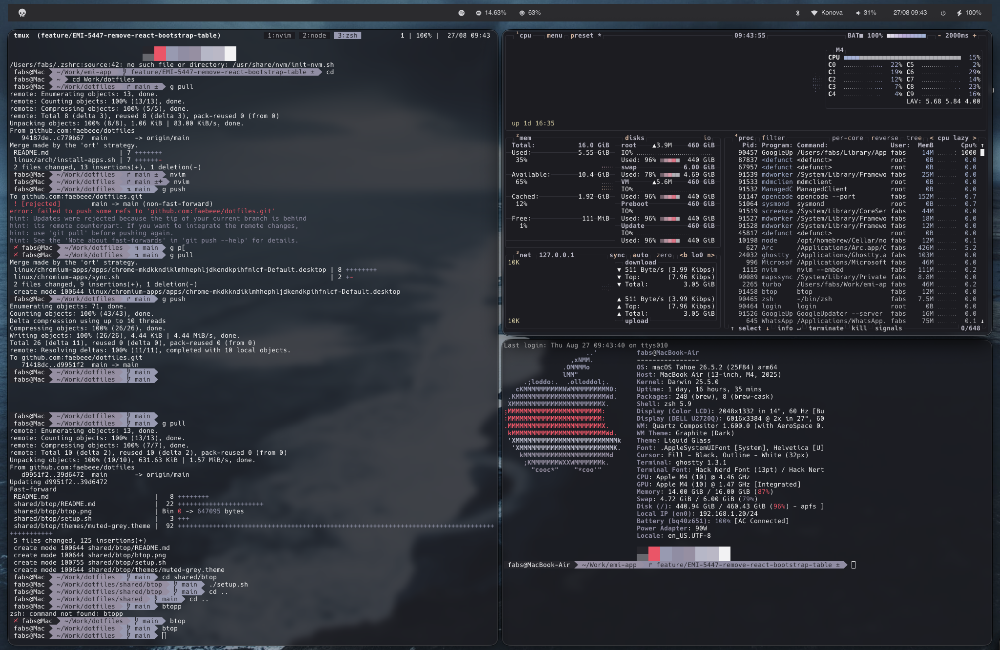

# AeroSpace

Config for [AeroSpace](https://github.com/nikitabobko/AeroSpace), a tiling window manager for macOS.

## Highlights

- Tiling and accordion layouts with configurable gaps
- Vim-style focus/move bindings (`alt-h/j/k/l`)
- Named workspaces: `DEV1`, `DEV2`, `BROWSER`, `MSG`, `TRMNL`, `5`-`9`
- Resize and manage modes
- Starts [JankyBorders](https://github.com/FelixKratz/JankyBorders) on launch to highlight active/inactive windows
- `exec-on-workspace-change` triggers the `aerospace_workspace_change` event so
  the [sketchybar](../sketchybar) workspace indicator stays in sync

## Setup

`setup.sh` symlinks `.aerospace.toml` to `~/.aerospace.toml`.
