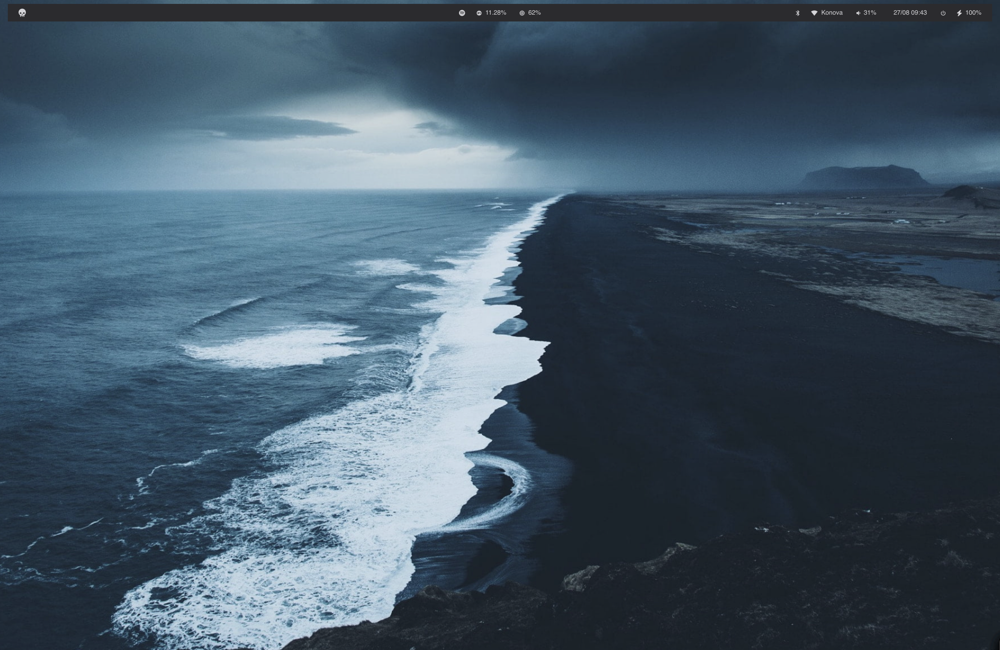

# SketchyBar

Config for [SketchyBar](https://github.com/FelixKratz/SketchyBar), a customizable macOS menu bar replacement.

## Highlights

- Three floating "islands" instead of one continuous bar: the bar itself is
  transparent and each group of items sits on its own rounded, shadowed
  bracket background
- Layout mirrors the [Noctalia](../../linux/noctalia-hypr/noctalia) bar: items
  grouped into `left` (start), `center`, and `right` (end) sections
- Left island: app launcher + AeroSpace workspace indicator
- Workspace indicator: one icon per AeroSpace workspace; the focused one is
  highlighted with a pill and spells out its name, empty/unfocused ones are
  hidden, and clicking a workspace switches to it. Driven by
  `exec-on-workspace-change` in [`.aerospace.toml`](../aerospace/.aerospace.toml),
  which triggers the `aerospace_workspace_change` event
- Center island: Spotify now-playing widget (popup for play/next/back/shuffle/repeat),
  CPU/GPU temps, CPU, memory and disk usage (stand-ins for Noctalia's `sysmon` widgets)
- Right island: wifi (click to open Wi-Fi settings), bluetooth (click to open
  Bluetooth settings), volume, clock, power/session menu (lock/sleep/logout/
  reboot/shutdown popup, mirroring Noctalia's `shell.session.actions`), battery
- Each module is backed by a plugin script in `plugins/`
- Colors, fonts and spacing live in `themes/` (`noctalia.sh` is the
  default, synced with the current Noctalia/Hyprland colorscheme;
  `muted-grey.sh` and `mono.sh` are also available); swap the theme by
  setting `THEME=<name>` before sketchybar loads, or add a new
  `themes/<name>.sh` file with the same variables to create a new look
- Island look is controlled by the `COLOR_ISLAND_*` and `ISLAND_*` theme
  variables (background, border, corner radius, height, shadow)
- Workspace indicator look is controlled by `COLOR_WORKSPACE_*`,
  `WORKSPACE_*` and `SHOW_EMPTY_WORKSPACES` (set it to `true` to always show
  every workspace, or `WORKSPACE_LABEL_ALWAYS=on` to always show names);
  per-workspace icons are mapped in `workspace_icons` in `sketchybarrc`
- Set `NOTCH_SPACING=true` in the theme (default `false`) to move the
  center island into the left section instead, so it doesn't get hidden
  behind a MacBook's notch

## Setup

`setup.sh` backs up any existing config and symlinks this whole directory to `~/.config/sketchybar`.
